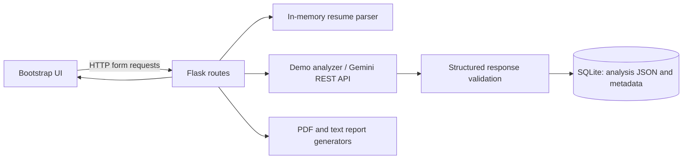

# System Architecture

## Components

Uploads are parsed in memory. The application stores generated analysis JSON, source filename, selected role, timestamp, and analysis mode; the structured analysis may include extracted resume details. The original file and a separate full-text copy are not stored. With Gemini enabled, the resume text is sent to Google's API from the backend.

## Database schema

`analysis`:

| Column | Type | Meaning |
|---|---|---|
| id | integer primary key | Analysis identifier |
| created_at | datetime | Creation time |
| original_filename | varchar(255) | Source label; not file content |
| target_role | varchar(100) | Requested role, if any |
| analysis_json | text | Validated structured analysis |
| analysis_mode | varchar(20) | `demo` or `gemini` |

## API / pages

| Method | Path | Purpose |
|---|---|---|
| GET | `/` | Home page |
| GET | `/dashboard` | Recent analysis history |
| GET, POST | `/upload` | Submit resume or text |
| GET | `/analysis/<id>` | Results page |
| GET | `/analysis/<id>/learning` | Learning recommendations |
| GET | `/analysis/<id>/report` | Download report text |
| GET | `/analysis/<id>/report.pdf` | Download PDF report |
| GET | `/about` | Privacy and usage information |

## Request workflow

The browser sends a multipart form to Flask. Flask validates role and text/file input, extracts the file content in memory, calls the Gemini integration when configured (otherwise demo analysis), validates the response, and saves only the result and limited metadata. The browser receives a redirect to the saved result page. Analysis history is local to the configured database.

## Security boundaries

The API credential is read from server environment configuration. Upload extension and request size are restricted. No uploaded file is saved. This implementation intentionally does not claim public deployment readiness: authentication, CSRF, rate limits, multi-user access controls, retention policy, and hardened production deployment remain necessary.
